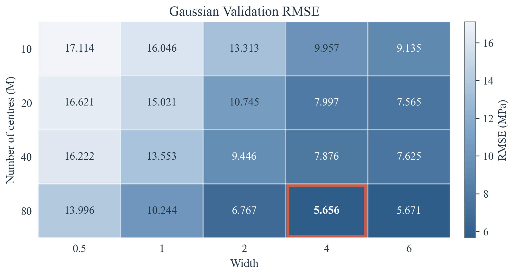
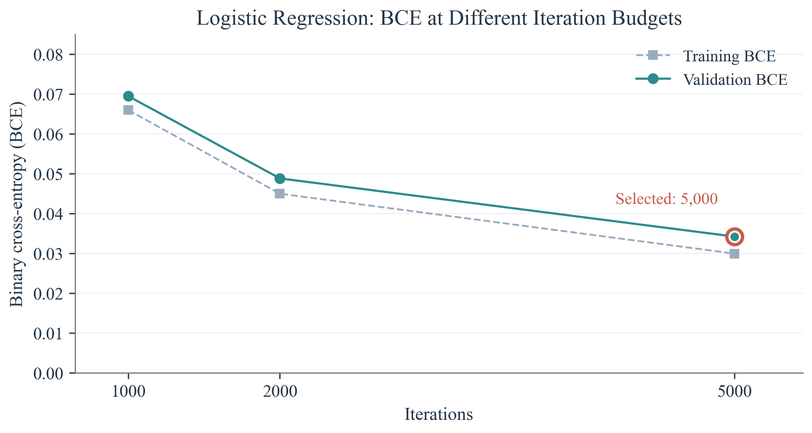
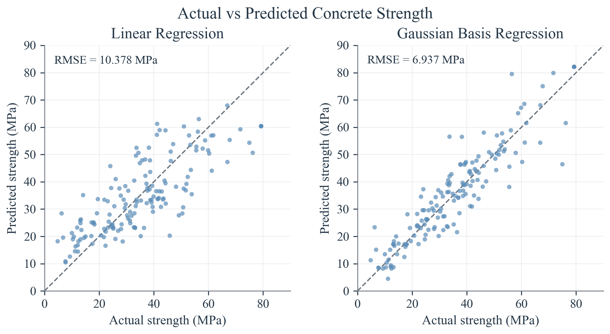
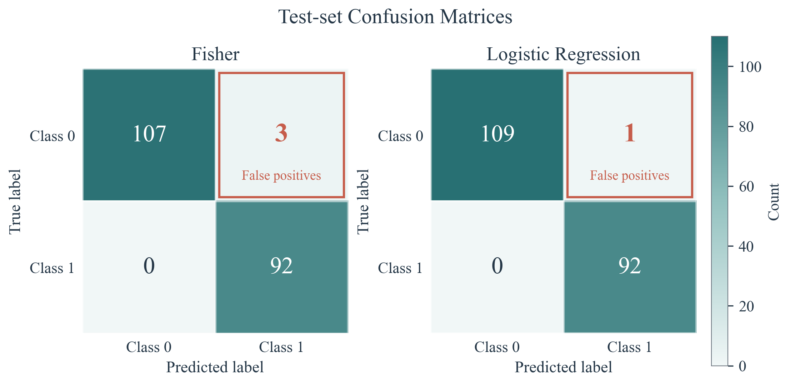

# Regression and Classification from Scratch

A reproducible comparison of four classical machine learning models implemented
with NumPy. Two real datasets illustrate how feature design, model complexity
and validation-based selection affect regression and classification performance.
Pandas handles tabular loading, while Matplotlib produces the visualizations.

## Models and experiments

| Task | Dataset | Models |
| --- | --- | --- |
| Regression | Concrete compressive strength | Linear least squares; Gaussian basis function regression |
| Binary classification | Banknote authentication | Fisher linear discriminant; Logistic Regression with batch gradient descent |

The implementation includes data checks, deterministic splitting, standardization,
parameter selection, predictions and evaluation metrics without a machine learning framework.

- **Regression:** identical eight-feature inputs stay in the same subset. All
  1,030 observations are retained, including duplicates; the split is 721/154/155.
  Standardization uses training statistics. Twenty Gaussian configurations are
  compared by validation RMSE, with distinct training inputs used as centres.
- **Classification:** removing 24 duplicate rows leaves 1,348 observations.
  A stratified 944/202/202 split preserves class proportions. Standardization uses
  training statistics. Fisher uses a midpoint projection threshold. Logistic
  Regression compares 1,000, 2,000 and 5,000 updates at learning rate 0.1, selects
  by validation BCE, and applies a fixed probability threshold of 0.5.

## Run locally

Tested with Python 3.13. Install the dependencies and run:

```bash
python -m pip install -r requirements.txt
python regression.py
python classification.py
python plot.py
```

The datasets are included. Paths are resolved from the scripts' locations.
The experiment scripts print metrics and write full-precision CSV results under
`outputs/regression/` and `outputs/classification/`. The plotting script reads
those results and writes PNG and PDF figures under `outputs/figures/`.
Checked-in CSV files also allow `python plot.py` to run without retraining.

## Results on the fixed splits

| Regressor | Test RMSE (MPa) | Test MAE (MPa) | Test R² |
| --- | ---: | ---: | ---: |
| Linear | 10.378484 | 8.395272 | 0.635492 |
| Gaussian basis | 6.937090 | 5.054179 | 0.837148 |

The Gaussian model uses 80 centres and width 4. Its training RMSE is 5.758212 MPa
and validation RMSE is 5.656038 MPa, with 81 fitted parameters including the intercept.

| Classifier | Test accuracy | Precision | Recall | F1 |
| --- | ---: | ---: | ---: | ---: |
| Fisher | 98.51% | 96.84% | 100% | 0.9840 |
| Logistic | 99.50% | 98.92% | 100% | 0.9946 |

Logistic Regression selects 5,000 updates with validation BCE 0.034216. The
accuracy difference corresponds to two fewer false positives out of 202 test records.

## Visual results

### Gaussian validation search



### Logistic training budgets



The lines connect three evaluated endpoints; they are not a continuous learning curve.

### Regression predictions



### Classification errors



## Project structure

```text
regression.py          Regression models, selection and result export
classification.py      Classification models, selection and result export
plot.py                Four visualizations from saved CSV data
requirements.txt       Tested dependency versions
data/                  Public numeric datasets and attribution
outputs/               Reproducible numerical results and example figures
```

## Interpretation and limits

Results describe these fixed splits rather than a universal model ranking.
Duplicate observations retain their weight in regression. The selected Gaussian
design matrix has condition number about 5.31e5; the best validation score among
twenty candidates can also be optimistic. The lower Logistic BCE does not by
itself establish convergence. Baseline classification test results were inspected
during development, before the later iteration-budget comparison; the final script
selects only by validation BCE, but the reused test set is not a fresh assessment.

## Dataset attribution

The data originate from UCI: [Concrete Compressive Strength](https://archive.ics.uci.edu/dataset/165/concrete+compressive+strength)
and [Banknote Authentication](https://archive.ics.uci.edu/dataset/267/banknote+authentication).
See [data/README.md](data/README.md) for the dataset citations, license and format details.
